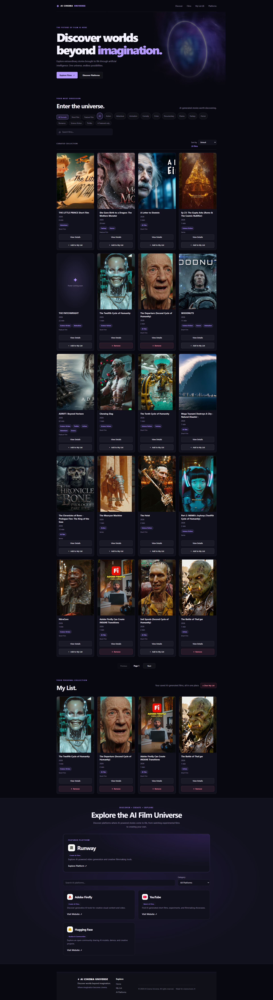

# 🎬 AI Cinema Universe

### Discover a universe of AI-generated cinema.

**Explore. Discover. Experience the future of storytelling.**

AI Cinema Universe is a cinema-inspired web platform designed to help users discover AI-generated films, explore film information, and find available viewing options.

Built with React and Vite, the project combines a modern cinematic interface with film discovery, search and filtering, detailed film information, a personal watchlist, and links to platforms related to AI filmmaking.

---

## 🌌 Live Preview

<p align="center">
  
</p>

<p align="center">
  <em>A cinematic interface for exploring AI-generated entertainment.</em>
</p>

<p align="center">
  <a href="https://ai-cinema-universe.vercel.app/">🚀 Visit Live Website</a>
  &nbsp; • &nbsp;
  <a href="https://github.com/Melvin-12143031/ai-cinema-universe">💻 View Source Code</a>
</p>

---

## ✨ Key Features

### 🎥 Cinematic Experience
- A visually immersive hero section with a cinematic background.
- Featured film content and prominent navigation actions.
- Custom branding and a dedicated favicon.
- A consistent, cinema-inspired visual design.

### 🍿 Film Discovery
- Browse a curated collection of AI-related films.
- Search the available film catalogue.
- Filter and sort films using the implemented controls.
- Navigate film collections with pagination.
- Explore film metadata, tags, and featured labels.

### ▶️ Film Information and Viewing Options
- View detailed information for selected films.
- Access available external film sources and viewing links.
- Explore creator and platform information when available in the film data.

### ❤️ Personal Watchlist
- Add films to My List.
- Remove individual saved films.
- Clear the watchlist through a confirmation dialog.
- Preserve saved selections with browser Local Storage.

*The watchlist is stored locally in the browser and does not automatically synchronize between devices.*

### 🌐 AI Cinema Platforms
- Explore platforms related to AI-generated entertainment.
- Provide users with additional destinations for discovering AI filmmaking tools and content.

### ⚡ Performance and Usability
- Optimized cinematic hero background using WebP image compression.
- Responsive layouts for different screen sizes.
- Reusable React components and organized project modules.
- Interactive controls and confirmation dialogs.

---

## 🔌 API Integration

### Hollywood.AI Agent Search API

AI Cinema Universe uses the Hollywood.AI service endpoint provided for searching AI-related entertainment.

**Endpoint**

`https://hollywood.ai/api/agent/search`

This integration supports the project's AI cinema discovery experience. The exact search parameters, returned fields, and supported filtering options depend on the API response and how they are used by the application.

**API provider:** [Hollywood.AI](https://hollywood.ai/)

**Endpoint URL:** [Hollywood.AI Agent Search](https://hollywood.ai/api/agent/search)

**Integration considerations**
- Retrieve data from an external API.
- Handle API responses in the application.
- Map returned data to the film interface where supported.
- Handle empty results or failed requests appropriately.

**Important:** This endpoint is for searching Hollywood.AI's catalogue. It should not be described as a movie-generation or video-hosting API unless those capabilities are separately integrated.

---

## 🛠️ Tech Stack

| Technology | Purpose |
|---|---|
| React | Component-based user interface |
| Vite | Development server and production builds |
| JavaScript (ES6+) | Application logic and interactions |
| CSS3 | Styling, layout, and responsive design |
| Hollywood.AI Agent Search API | AI entertainment discovery integration |
| Lucide React | Interface icons |
| Browser Local Storage | Persistent watchlist data |
| WebP | Optimized hero background image |
| Git | Version control |
| GitHub | Source code hosting |
| Vercel | Production deployment |

---

## 🧠 Technical Highlights

This project demonstrates practical frontend development skills through:

- **Component-based architecture:** Building reusable interface components.
- **State management:** Handling film selection, filtering, pagination, and watchlist interactions.
- **Custom React hooks:** Separating reusable state and application logic.
- **API integration:** Connecting an application to an external data service.
- **Browser storage:** Persisting watchlist data across page reloads.
- **Interactive UI:** Implementing dialogs, navigation, search controls, and user actions.
- **Asset optimization:** Compressing the hero background from approximately 3.16 MB to 17.91 KB.
- **Production readiness:** Running lint checks and production builds.
- **Deployment workflow:** Publishing source code to GitHub and deploying the application through Vercel.

---

## 🚀 Getting Started

Run AI Cinema Universe locally using the following instructions.

### Prerequisites

- [Node.js](https://nodejs.org/)
- npm
- [Git](https://git-scm.com/)

### 1. Clone the repository

```bash
git clone https://github.com/Melvin-12143031/ai-cinema-universe.git
```

### 2. Navigate to the project folder

```bash
cd ai-cinema-universe
```

### 3. Install dependencies

```bash
npm install
```

### 4. Start the development server

```bash
npm run dev
```

### 5. Open the application

Open the local URL displayed in your terminal.

---

## 📦 Production Commands

### Build for production

```bash
npm run build
```

### Preview the production build

```bash
npm run preview
```

### Run lint checks

```bash
npm run lint
```

---

## 📂 Project Structure

```text
ai-cinema-universe/
├── public/
│   ├── screenshot.png
│   └── favicon.ico
├── src/
│   ├── assets/
│   │   └── ai-cinema-hero.webp
│   ├── components/
│   ├── data/
│   │   ├── movieTypes.js
│   │   ├── movies.js
│   │   └── platforms.json
│   ├── handlers/
│   │   └── movieHandlers.js
│   ├── hooks/
│   │   ├── useMovies.js
│   │   └── useMyList.js
│   ├── pages/
│   │   └── MyListPage.jsx
│   ├── services/
│   │   └── movieService.js
│   ├── App.jsx
│   ├── App.css
│   ├── index.css
│   └── main.jsx
├── index.html
├── package.json
├── .gitignore
└── README.md
```

---

## 💾 Watchlist Storage

The My List feature uses browser Local Storage to preserve saved films between page reloads.

- Saved entries remain available in the same browser.
- Clearing browser storage may remove saved entries.
- Watchlist data is not automatically synchronized between devices or user accounts.

---

## ⚡ Image Optimization

The cinematic hero background was converted from PNG to WebP to reduce its file size.

| Asset | Approximate size |
|---|---:|
| Original PNG | 3.16 MB |
| Optimized WebP | 17.91 KB |

This represents approximately **99.4% less image data** for the hero background, helping reduce the amount of data the browser needs to download for that asset.

---

## 🔮 Future Improvements

Potential enhancements for future versions include:

- User authentication and cross-device watchlist synchronization.
- Expanded discovery and filtering options.
- Additional film metadata and creator information.
- Improved accessibility and loading states.
- More robust API error handling and data validation.

---

## 🌍 Project Links

- **🚀 Live Website:** [AI Cinema Universe](YOUR-VERCEL-URL)
- **💻 GitHub Repository:** [Melvin-12143031/ai-cinema-universe](https://github.com/Melvin-12143031/ai-cinema-universe)
- **🔌 API Provider:** [Hollywood.AI](https://hollywood.ai/)

---

## 👨‍💻 About the Project

AI Cinema Universe is a personal portfolio project created to develop practical frontend engineering skills through a cinematic web experience.

The project brings together UI design, React component architecture, state management, external API integration, browser storage, asset optimization, version control, and deployment.

It represents a hands-on step toward building more interactive, maintainable, and production-ready web applications.

---

<p align="center">
  <strong>AI Cinema Universe</strong>
  <br>
  <em>Explore stories beyond the ordinary. 🍿</em>
</p>
